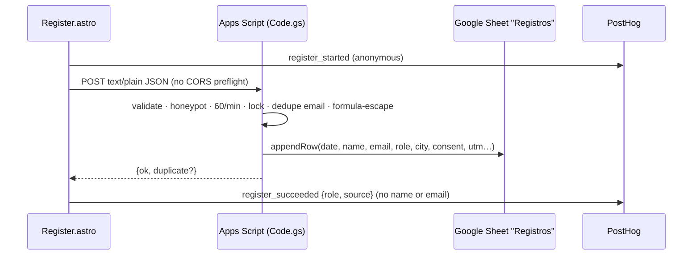

# Sign-ups → Google Sheets

The "Avísame primero" form on the landing posts to a Google Apps Script web app, and the script appends one row per person to a spreadsheet. You don't need a server, a Google Cloud project or a service-account key.

## How a sign-up flows

There is no server of our own: the static page posts straight to the Apps Script web app.



Inside `doPost`, each request goes through these checks in order:

```text
doPost (Code.gs v3)
  body > 2 KB / not a JSON object        → too_large / bad_request
  honeypot filled  or  elapsed < 2.5 s   → {ok:true}, nothing written (bots don't learn)
  validate()                             → name | email | email_disposable | role | city | consent
  cache em_<key> (10 min)                → {ok:true, duplicate:true}, sheet untouched
  lock
    > 60 sign-ups this minute            → rate_limited
    "Clave correo" or Correo exists      → {ok:true, duplicate:true}
    appendRow (= + - @ escaped), then set the 10-min cache
```

## Setup (about 5 minutes)

1. Create a Google Sheet, for example "FlutterConf Perú 2026 · Registros", with the account that should own the data.
2. In the sheet, open **Extensions → Apps Script**.
3. Replace the contents of `Code.gs` with [`Code.gs`](./Code.gs) from this folder, then save.
4. Click **Deploy → New deployment**, choose the type **Web app**, and set:
   - *Execute as:* **Me**
   - *Who has access:* **Anyone**
5. Click **Deploy** and authorize the script. Google warns that the app is unverified: choose *Advanced → Go to …* (it is your own script).
6. Copy the **Web app URL**. It ends in `/exec`.
7. Paste the URL into `.env` as `PUBLIC_REGISTER_ENDPOINT=…` for local work, and add a repository secret with the same name for the deploy (GitHub → Settings → Secrets and variables → Actions).
8. Test it: open the URL in a browser, and it should answer `{"ok":true,…}`. Then submit the form from `npm run dev`. A **Registros** tab with headers appears on the first sign-up.

When you change `Code.gs`, use **Deploy → Manage deployments → Edit → Version: New version**. That keeps the same URL. A *new deployment* creates a new URL.

Check the deployment any time with `npm run check:keys`. It reports the deployed `Code.gs` version and probes the validations without writing any row.

## Sheet structure

The script writes to a tab called **Registros**. It creates that tab and its header row on the first sign-up, and it never edits or deletes existing rows.

| # | Column | Example | What it is | What it's for |
| --- | --- | --- | --- | --- |
| A | **Fecha (Lima)** | `2026-11-17 16:34:53` | Server time of the sign-up, Lima time (UTC−5) | Sign-ups per day and growth after each post |
| B | **Nombre** | `Ana Quispe` | Name as typed: letters, accents, `'`, `.`, `-` | Personalizing emails |
| C | **Correo** | `ana.quispe@gmail.com` | Email as typed, lowercased | Where the news goes |
| D | **Perfil** | `dev-flutter` | Answer to "¿Cómo te describes?" (codes below) | Audience mix: tune talks and sponsor pitches |
| E | **Ciudad** | `Lima` | Optional, as typed | How many come from outside Lima |
| F | **Acepta correos** | `Sí` | Proof that the person ticked the consent box. Always `Sí`, because the form can't be sent without it | Legal record of consent for marketing email (Peru's Ley 29733). Keep it, even if it looks redundant |
| G | **Fuente** | `instagram` | Where the visit came from: `?ref=`, else `utm_source`, else the referring site, else `directo` | Which channel brings sign-ups |
| H | **UTM source** | `instagram` | `utm_source` from the link | Campaign attribution |
| I | **UTM medium** | `social`, `story`, `email` | `utm_medium` from the link | Which format works |
| J | **UTM campaign** | `lanzamiento` | `utm_campaign` from the link | Which campaign or post works |
| K | **Página** | `/flutterconf_peru_2026/` | Path of the page where the form was sent | Today the site has one page, so it is always the same. It starts to matter when the full landing returns with more pages. Safe to ignore or hide |
| L | **Clave correo** | `anaquispe@gmail.com` | Normalized email (lowercase, no `+tag`, Gmail without dots), used by the script to spot duplicates | Technical: the script reads it on every sign-up. **Don't edit or delete it**, but you can hide it (right-click column L → *Hide column*) |

**Perfil codes:** `estudiante` (Estudiante), `dev-flutter` (Dev Flutter o Dart), `dev-otro` (Dev de otro stack), `diseno-producto` (Diseño o producto), `lider-empresa` (Líder o empresa), `otro` (Otro).

**Rows with an empty "Clave correo"** were written by version 1 of the script, before the key column existed. Duplicate checks still catch them, through the **Correo** column.

### Tagging links so the analytics columns fill in

Columns G to J only fill in when the link people click carries the tags. Use one link per post:

```
https://enzoftware.github.io/flutterconf_peru_2026/?utm_source=instagram&utm_medium=story&utm_campaign=lanzamiento
https://enzoftware.github.io/flutterconf_peru_2026/?utm_source=linkedin&utm_medium=post&utm_campaign=lanzamiento
https://enzoftware.github.io/flutterconf_peru_2026/?ref=gdg-lima        # short form, fills only Fuente
```

Use lowercase and no spaces, and reuse the same words, so `instagram` and `Instagram` don't count as two sources. The share button on the success screen adds `?ref=share` by itself.

### Handy formulas (in another tab)

| What | Formula |
| --- | --- |
| Total sign-ups | `=COUNTA(Registros!C2:C)` |
| Sign-ups today | `=COUNTIFS(Registros!A2:A, ">=" & TODAY(), Registros!A2:A, "<" & TODAY() + 1)` |
| By profile | `=QUERY(Registros!A:L, "select D, count(C) where C is not null group by D order by count(C) desc", 1)` |
| By source | `=QUERY(Registros!A:L, "select G, count(C) where C is not null group by G order by count(C) desc", 1)` |
| By campaign | `=QUERY(Registros!A:L, "select J, count(C) where J is not null group by J order by count(C) desc", 1)` |

You can delete test rows by hand at any time. If you change the header row, the script restores it on the next sign-up. Insert extra columns only to the right of L.

PostHog also gets a `register_succeeded` event without personal data, so the funnel (page view → form started → sign-up) lives there.

## Spam, duplicates and security

The web app URL is public because the static page needs it, so every rule is enforced on the server (`Code.gs`). The form runs the same rules (`src/lib/registration.ts`) so people see the error right away.

| Threat | Defense |
| --- | --- |
| Bots filling every field | Hidden honeypot field `website`. The server answers ok and writes nothing, so bots don't learn they were caught |
| Bots submitting instantly | Time trap: anything sent less than 2.5 s after the page loaded is dropped the same way |
| Link spam in free text | Names and cities accept only letters, accents, spaces, `'`, `.` and `-`. No digits, URLs, domains or `<>` |
| Fake or throwaway emails | Strict email format, plus a blocklist of disposable inbox providers (mailinator, yopmail…) |
| Duplicates | One row per inbox. The key ignores case, `+tags` and Gmail dots (`Ana.Q+pe@gmail.com` = `anaq@gmail.com`). It is stored in the **Clave correo** column. The browser also remembers a successful sign-up and says "ya estabas en la lista" |
| Hammering | The same inbox at most once every 10 minutes, and 60 sign-ups per minute overall |
| Oversized or malformed requests | 2 KB body limit, JSON parsed inside try/catch, unknown roles refused, consent must be exactly `true` |
| Formula injection | Values starting with `= + - @` are stored as text, so opening the sheet never runs them |
| Concurrent writes | A script lock around the duplicate check and the append |

What it can't do: Apps Script doesn't expose the caller's IP or `Origin` header, so it can't block one client or one website. If spam gets through anyway, add Cloudflare Turnstile: a site key in the form, with the secret kept in the script's **Project Settings → Script properties**.

Privacy: the sheet stays private, because only the script, running as you, can write to it, and nobody can read it through the URL. The data is personal (name and email). Share the sheet only with the organizers, and use it only for what the form promises: news about FlutterConf Perú.

## Tests

`npm test` runs `Code.test.mjs`, which loads `Code.gs` in Node with in-memory fakes of SpreadsheetApp, CacheService and LockService. It also runs the same validation cases against the form rules, so the two can't drift apart.
